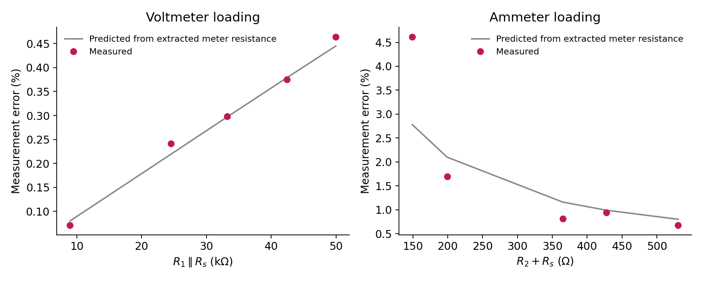
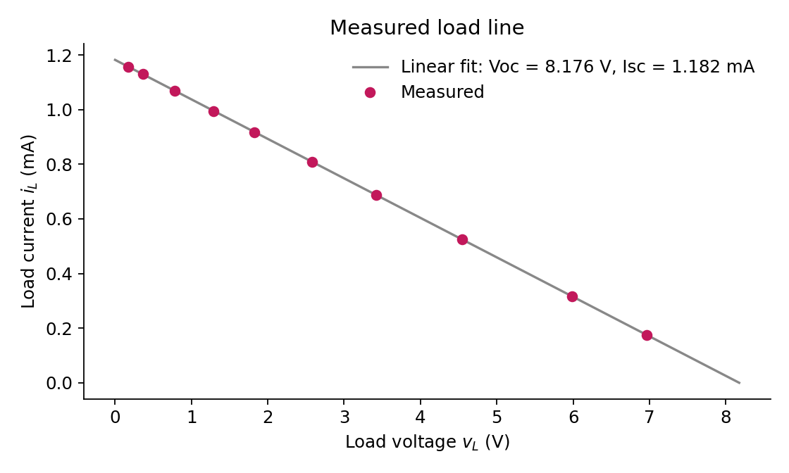

# Circuit Measurement & Characterization

Bench measurements from ECEN 50L (Electric Circuits I Lab) at Santa Clara University, completed with lab partners. This repo summarizes what I measured and what I learned about how test equipment affects a circuit. It includes my data and plots, not course materials or assignment solutions.

**Equipment:** Keysight bench DMM, handheld DMM, DC power supply, resistance decade box, breadboard  
**Analysis:** MATLAB

## Meter loading

A meter changes the circuit it measures. I measured how much, then worked backward to find each meter's internal resistance.

| Meter | Model value | Extracted value (average) | Largest error seen |
|---|---|---|---|
| Voltmeter | 10 MΩ | 11.17 MΩ | 0.46% |
| Ammeter | 1 Ω | 4.27 Ω | 4.62% |

The ammeter result was well above the model value. Test leads, the fuse, and breadboard contacts add series resistance. The calculation also subtracts two large, nearly equal numbers, so small measurement errors have a big effect. That's why the lowest-resistance trial gave 7.2 Ω.

**Takeaway:** A voltmeter's resistance should be much larger than the circuit it measures, and an ammeter's should be much smaller.

## Wheatstone bridge

I built a bridge with a decade box and balanced it to measure resistance by a null reading, then compared the results with direct DMM readings.

| Measured | DMM | Bridge |
|---|---|---|
| Resistor Ra | 8.335 kΩ | 8.3355 kΩ (voltmeter detector), 8.3411 kΩ (ammeter detector) |
| Resistor Rb | 11.89 kΩ | 11.9267 kΩ |
| DMM ammeter internal resistance | 1.2 Ω | 1.1969 Ω |
| Photoresistor in light | 1.863 kΩ | 1.8999 kΩ |
| Photoresistor in dark | 2.567 MΩ | 2.567 MΩ |

The bridge measured the ammeter at about 1.2 Ω, far below the 4.27 Ω from the first experiment. The earlier method also picked up lead and contact resistance and amplified small errors, so the comparison showed how much the method affects the result.

**Takeaway:** At balance, almost no current flows through the detector, which minimizes meter loading. The same setup also worked for light sensing across a range of more than three orders of magnitude.

## Thevenin equivalent

I reduced a multi-source resistor network to a Thevenin equivalent and checked it with three independent methods.

| Method | Rth |
|---|---|
| Calculated from node-voltage analysis | 6.903 kΩ |
| Open-circuit voltage / short-circuit current | 6.914 kΩ |
| Linear fit of 10 measured load points | 6.917 kΩ |
| Test source with independent sources deactivated | 6.918 kΩ |

The measured methods agreed within 0.004 kΩ, and all were within about 0.2% of the calculated value. Measured open-circuit voltage came in about 1.8% above theory (8.168 V vs. 8.025 V).

## Data

Raw measurements are in [`data/`](data/).
